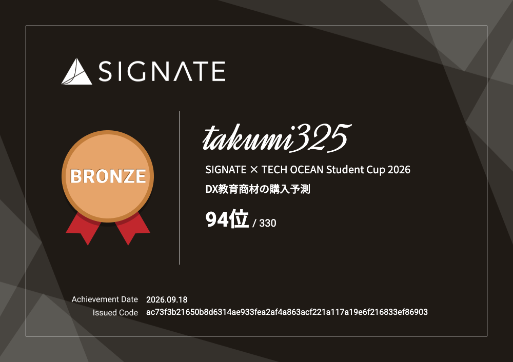

**日本語** | [English](README.en.md)

## 古谷 匠 / Takumi Kotani

静岡大学 工学部 数理システム工学コース 3年。現場で使われるアプリを作ることと、データで判断材料を作ることの両方をやっています。

**できること**

- **現場で使われるアプリを一人で作り、運用できる**：アルバイト先の飲食店で毎日の営業に使われている卓タイマー「Minopal」を、設計からリリース運用まで一人で担当
- **データ基盤とデータ分析で、判断材料を作れる**：インターン2社でBigQueryのデータ基盤を担当。
- **短期間で形にできる**：Minopalは3週間で105本のPRを出し、21回リリース。内閣官房 データ活用ハッカソンでデータ活用賞

[Email](mailto:kotani.takumi.24@shizuoka.ac.jp) 

---

##  実務・運用：Minopal（飲食店ホール用の卓タイマー）

[リポジトリ](https://github.com/kotani-takumi0/table_check_app)

アルバイト先の居酒屋で、ホールスタッフが営業中に店のiPadやスマホで使っているアプリです。

- **解決したこと**：お通しの出し忘れ、ラストオーダーの声かけ漏れ、お席の時間の超過を、それまではスタッフが頭で覚えていました。Minopalでは空席をタップして案内すると卓ごとに時間を数え始め、声かけが必要な卓が色でひと目で分かります
- **利用状況**：2026年9月25日に最初の版を店に入れ、今も毎日の営業で使われています。複数の端末で同じ画面を共有しています
- **担当範囲**：店での聞き取り、画面設計、実装、Firebase（Firestore・Hosting・認証）の構築、セキュリティルール、リリースまで一人で担当
- **作り方**：Claude CodeとCodex,Grok botを使い、3週間で105本のPRを出して21回リリース。店で使ってもらいながら直してきました。たとえば次のような改善です
  - 急いで2回押しても1段しか進まないようにし、6秒間は「元に戻す」で戻せるようにした
  - 新しい版を出すと、開いたままの端末も自動で新しい版になるようにした
  - アプリから直接ご意見を送れるようにした
- **スタッフの声**：「ラストオーダーの管理が楽になった」「意見を送るとすぐ対応してもらえてありがたい」
- **技術**：TypeScript, React, Vite, Firebase, Expo（React Native、iOS版）, Vitest

  

---

## インターン

| 企業 | 期間 | やったこと | 技術 |
|---|---|---|---|
|  ABCテレビ（Tech InternShip） | 2026年8〜9月 | ラジオの音声を文字に起こして構造化し、聞いている人がどこで離れたかを分析できる形にした。AirflowのDAGに処理を追加し、Dockerで立てたAirflowで取り込みを確認 | BigQuery, Airflow, Docker, Gemini |
|  pixiv（summer boot camp 2026 データ基盤コース） | 2026年夏 | BigQueryの参照されていないテーブルを見つけるCLIツールをPythonで作り、実際に不要なテーブルを削除した | Python, BigQuery, SQL |

---

## 主な成果

| 大会 | 結果 | 課題 | やったこと |
|---|---|---|---|
| [学生データ分析 AWARD 2026](https://github.com/kotani-takumi0/data_award_2025_app) | **最優秀賞（1位）** | 豊島区の2040年に向けた人口動態 | 出生率の予測、ワンルームマンション税の効果を合成コントロール法で検証、23区の定住率比較を統合して分析 |
| [内閣官房 データ活用ハッカソン 2025](https://github.com/kotani-takumi0/policy_seed_hackathon) | **データ活用賞** | 新しい政策事業の予算規模の見積もり | 行政事業レビューの過去事業をEmbeddingsで類似検索し、推定予算を出すツールをFastAPIで作成 |
| [SIGNATE × TECH OCEAN Student Cup 2026](assets/signate_bronze.png) | **ブロンズメダル（94位 / 330）** | どの企業がDX教育商材を購入するかの予測 | 財務データ・企業情報・アンケートの自由記述という形式の違うデータを組み合わせ、二値分類モデルを作成（評価指標 F1） |

SIGNATE ブロンズメダルの証明書

 

---

## その他の作品

| 名前 | 内容 | 技術 |
|---|---|---|
| [Beeport](https://github.com/kotani-takumi0/beeport) | AIを使った開発の過程を自動で記録し、本人の理解度を見えるようにするポートフォリオサービス | React 19, TypeScript, FastAPI, PostgreSQL, MCP |
| [StratMind](https://github.com/kotani-takumi0/StratMind) | 過去の意思決定事例から、新しい企画への「問い」を生成するセルフレビュー支援ツール | FastAPI, OpenAI API, Embeddings |
| [FirstByte](https://github.com/kotani-takumi0/firstbyte) | AIが書いたコードと本人の理解のギャップを埋める学習支援サービス（GDGoC Japan Hackathon 2026 出場） | TypeScript, React |
| [ジモカ](https://github.com/kotani-takumi0/jimoka) | 出身地の魅力をカードにして共有するアプリ（関西ビギナーズハッカソン vol.7 出場） | React, TypeScript, Vite, Playwright |

---

## 技術スタック

**業務で使える**

TypeScript, React, Vite, Firebase（Firestore・Hosting・Auth）, Python（pandas）, FastAPI, SQL, BigQuery, Git / GitHub, Vitest, Claude Code

**触ったことがある**

Docker, PostgreSQL, C++（競技プログラミング）, Expo / React Native, Airflow, SQLAlchemy, Qdrant, OpenAI API, Gemini API, MCP, Playwright

**データ分析**

統計的推定・検定, 因果推論（合成コントロール法）, 機械学習による分類, 深層学習の基礎

**AI**

  

Claude Code, Codex, Grok Bot

---

## 資格・講座

- 統計検定2級（日本統計学会）
- GCI データサイエンティスト育成講座 修了（東京大学 松尾研究室）
- DL基礎講座 修了（東京大学 松尾研究室）

## 学歴

- 静岡大学 工学部 数理システム工学コース 3年

## 連絡先

- Email：[kotani.takumi.24@shizuoka.ac.jp](mailto:kotani.takumi.24@shizuoka.ac.jp)
